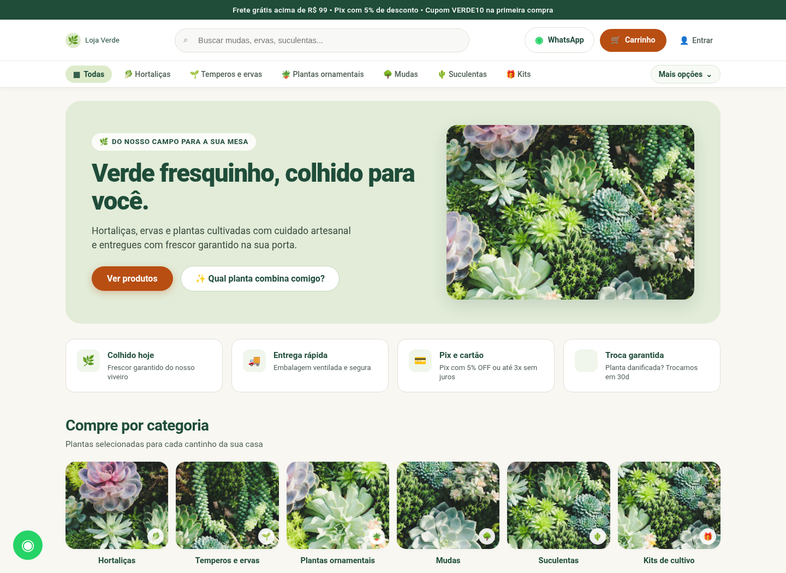
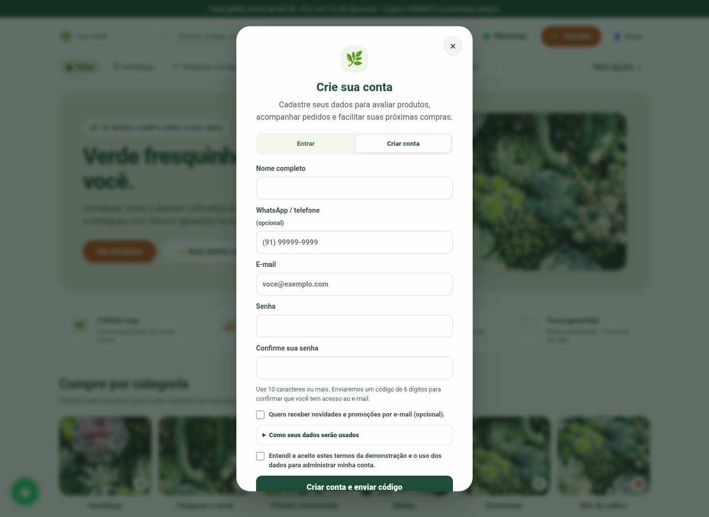
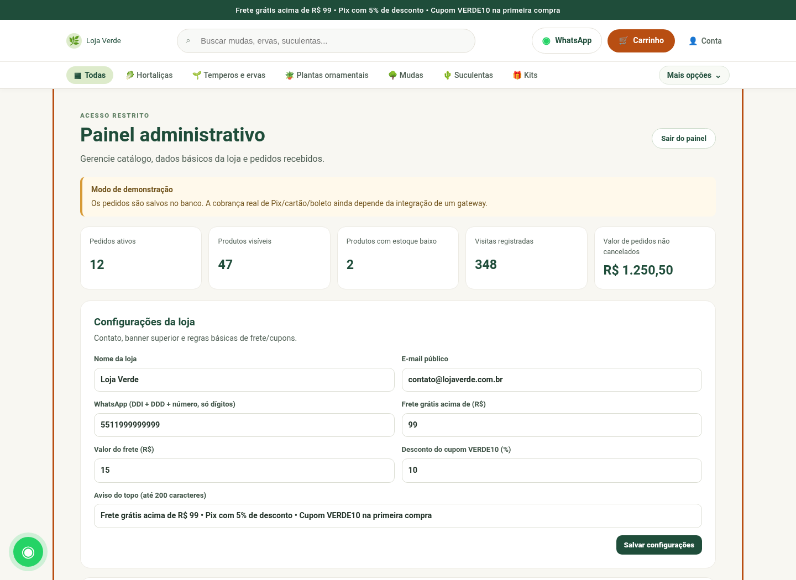
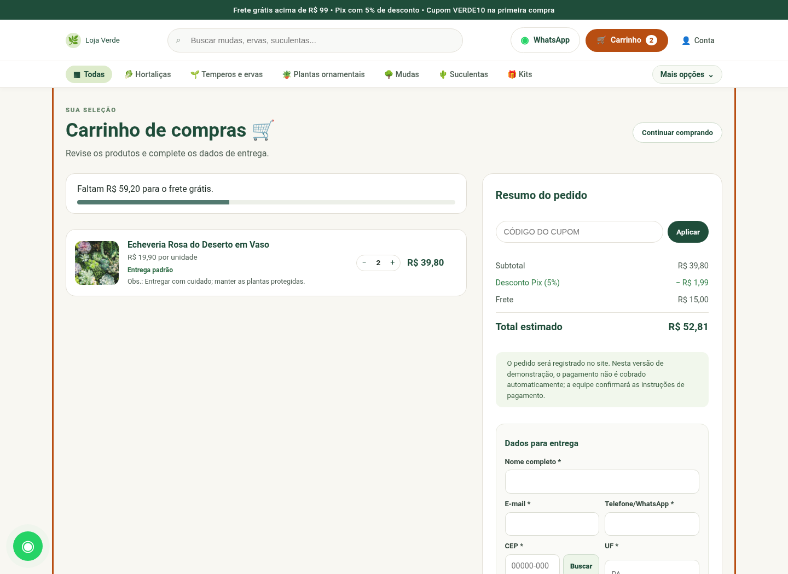

# Loja Verde — catálogo ampliado, conta e autenticação por e-mail

Projeto com **HTML, CSS, JavaScript, Node.js/Express e SQLite**. O catálogo inicial foi ampliado de 17 para **47 itens** (30 novos produtos). Os novos itens são inseridos automaticamente no banco com `INSERT OR IGNORE`: isso inclui catálogo novo sem sobrescrever preço/estoque já editados no painel.

## Capturas de tela do site

As imagens abaixo foram capturadas do frontend do projeto em uma renderização local para documentação. **A camada de API foi simulada para permitir a captura offline**: elas demonstram o visual e os componentes de interface, não uma implantação pública nem a validação de integrações de pagamento/e-mail. A seção de avaliações permanece vazia quando não existem avaliações reais cadastradas. O painel usa números demonstrativos e está identificado como tal. Como esta renderização foi feita sem acesso à internet, as fotos remotas da home foram substituídas temporariamente por recortes da foto de planta já enviada na conversa; isso vale apenas para os arquivos de captura e não altera as imagens/URLs do catálogo do projeto.

<table>
  <tr>
    <td width="50%"><strong>Página inicial — desktop</strong><br></td>
    <td width="50%"><strong>Detalhe do produto</strong><br></td>
  </tr>
  <tr>
    <td><strong>Cadastro de conta</strong><br></td>
    <td><strong>Avaliações e entrega</strong><br></td>
  </tr>
  <tr>
    <td><strong>Comerciantes &amp; Grupo VIP</strong><br></td>
    <td><strong>Painel administrativo — prévia</strong><br></td>
  </tr>
  <tr>
    <td><strong>Carrinho e checkout</strong><br></td>
    <td><strong>Versão para celular (390 px)</strong><br></td>
  </tr>
</table>

### Outras capturas

- [Navegação com a sanfona aberta](docs/navigation-expanded.png)
- [Detalhe do produto em celular](docs/product-detail-mobile-390.png)
- [Checkout completo — captura longa](docs/cart-full-page.png)
- [Página Comerciantes & Grupo VIP — captura longa](docs/merchant-vip-full-page.png)
- [Capturas de etapas anteriores do desenvolvimento](docs/history/)


## Iniciar no Windows

1. Instale Node.js 20 ou superior: https://nodejs.org/
2. Extraia o ZIP inteiro em uma pasta local.
3. Execute `iniciar_servidor.bat` no Windows. Ele instala as dependências na primeira execução.
4. Abra `http://127.0.0.1:5000` — não abra `index.html` diretamente.
5. O terminal mostra a chave administrativa somente quando ela é criada. Guarde-a; não publique a chave nem o arquivo `.env`.

## Verificações automatizadas

Na pasta do projeto, execute `npm run check` para verificar a sintaxe JavaScript e `npm test` para rodar os testes automatizados do catálogo. Os testes não substituem uma execução real do servidor e do provedor de e-mail.

## Cadastro, e-mail e perfil

O cadastro agora contém nome, e-mail, telefone opcional, senha e confirmação, consentimento dos termos da demonstração e preferência opcional por novidades. O e-mail é verificado por um código de 6 dígitos com validade de 10 minutos. Há proteção contra excesso de tentativas, limite de reenvios e códigos armazenados como HMAC, não como texto puro. Também há fluxo de recuperação de senha por e-mail, com código temporário. O perfil permite editar nome/telefone/preferência de novidades e consultar pedidos feitos enquanto a conta estava conectada. O carrinho e os dados de checkout são separados por conta; carrinhos antigos de visitante não são mostrados para outros usuários. A sessão do navegador é encerrada ao atualizar a página, então o usuário precisa entrar novamente.

### Carrinho e Comerciantes & Grupo VIP (acesso obrigatório)

Para adicionar produtos, ver ou alterar o carrinho e finalizar pedidos, a pessoa precisa entrar em uma conta com e-mail verificado. Ao clicar nessas ações sem sessão, a loja abre o cadastro/login e, depois da verificação/login bem-sucedido, retoma a ação solicitada. O contador do carrinho fica oculto enquanto a pessoa está desconectada. O carrinho e os dados de entrega são guardados por ID de usuário no navegador para não misturar informações entre contas.

A página **Comerciantes & Grupo VIP** também exige conta autenticada. O formulário usa o e-mail verificado da conta e associa a solicitação de parceria ao usuário. A API do servidor exige token válido para carregar as promoções, cadastrar comerciante ou registrar um pedido; não basta remover a restrição visual no navegador. Ao sair da conta, a tela volta à loja pública para não deixar o carrinho ou a área VIP visíveis atrás da janela de login.
## Repaginação de Comerciantes & Grupo VIP

A área recebeu um novo layout responsivo com destaque de parceria, benefícios, identificação da conta conectada, formulário comercial organizado, etapas explicativas e cartões de promoções. O formulário mantém os mesmos endpoints e validações de acesso; promoções são inseridas com `textContent` para evitar interpretar conteúdo recebido da API como HTML. A página não inventa um link de grupo VIP: explica que os acessos exclusivos dependem da análise da parceria.


### Configurar envio real por e-mail (necessário fora da demonstração)

1. Crie uma conta no [Resend](https://resend.com/), gere uma API key e valide um domínio/remetente na plataforma.
2. Pare o servidor (`Ctrl+C`) e edite o arquivo `.env` criado na pasta do projeto. Configure, por exemplo:

```env
NODE_ENV=production
RESEND_API_KEY=re_sua_chave_real
EMAIL_FROM=Loja Verde <verificacao@seudominio.com>
```

Use no `EMAIL_FROM` exatamente um endereço/domínio autorizado pelo provedor. **Não compartilhe nem envie sua `RESEND_API_KEY` em chats, prints ou repositórios.** Salve o `.env` e reinicie `iniciar_servidor.bat`. O endpoint `/api/health` informa apenas se o envio está configurado; nunca expõe a chave. Na hospedagem pública, mantenha `ADMIN_API_KEY` e `OTP_SECRET` persistentes nas variáveis de ambiente do serviço, defina `HOST=0.0.0.0` e use o `PORT` fornecido pela plataforma; não dependa de um `.env` local que possa ser apagado ao reiniciar.

Quando o provedor de e-mail não estiver configurado e o servidor estiver em desenvolvimento, a aplicação poderá mostrar um código de demonstração na tela para teste local. Com `NODE_ENV=production`, esse código não é retornado: a configuração de e-mail é exigida para criar contas e recuperar senhas.

> O e-mail real **não foi testado neste ambiente** porque exige uma chave Resend e um remetente verificado que pertencem ao dono da loja. A entrega só pode ser confirmada depois de configurar essas credenciais e receber uma mensagem em uma caixa de correio real.

## Catálogo: mais 30 plantas

Foram adicionadas 30 entradas, IDs 18–47, incluindo lavanda, jiboia, espada-de-São-Jorge, antúrio, maranta, peperômia, filodendro, calatéia, cactos, Haworthia, Sedum, jade, tomate-cereja, pimenta-biquinho, morango, mudas de limão/pitanga/acerola/goiaba, capim-limão, orégano, tomilho, sálvia, coentro, cebolinha, salsinha, begônia maculata, violeta-africana, gerânio e bromélia. Quantidade, preço, descrição, cuidados, produtor, visibilidade e URL de imagem podem ser ajustados na administração. Algumas fotos são placeholders visuais do catálogo; revise/substitua cada imagem e confirme estoque e preço antes de vender.

## APIs atuais e auditoria

- **Resend (e-mail transacional):** integrado para validar cadastro e recuperar senha. Requer chave e domínio/remetente verificado do dono da loja. Referência: https://resend.com/docs/api-reference/emails/send-email.
- **ViaCEP:** usado para auxiliar o preenchimento de endereço no checkout; é suficiente para consulta básica de CEP, mas não calcula preço nem prazo de frete. Referência: https://viacep.com.br/.
- **API interna da Loja Verde:** catálogo, avaliações, visitantes, pedidos, perfil/conta, autenticação, recuperação de senha e administração usam a mesma API Node/Express. Não é necessário CORS separado na configuração local de mesma origem.
- **Gateway de pagamento:** ainda necessário para cobrar de verdade por Pix/cartão/boleto (por exemplo, Mercado Pago). Faltam criação de cobrança, idempotência, atualização de status e webhook validado no servidor. A documentação oficial explica a criação de ordens Pix e notificações: https://www.mercadopago.com.br/developers/pt/reference e https://www.mercadopago.com.br/developers/pt/docs/split-payments/additional-content/your-integrations/notifications/webhooks. Nenhuma cobrança real é feita atualmente.
- **API de frete:** opcional para demonstração com taxa fixa; necessária se a loja for informar preço e prazo reais por endereço/transportadora.
- **Imagens:** são URLs externas estáticas; não há API paga de imagens obrigatória. Antes de vender, valide os direitos e a correspondência das fotos, ou hospede imagens próprias.

### APIs principais

Públicas: `GET /api/health`, `GET /api/configuracoes/publicas`, `GET /api/produtos`, `GET /api/produtos/:id/avaliacoes`, `POST /api/visitante/rastrear`, `POST /api/auth/registrar`, `POST /api/auth/verificar-email`, `POST /api/auth/reenviar-codigo`, `POST /api/auth/login`, `POST /api/auth/solicitar-redefinicao`, `POST /api/auth/redefinir-senha`.

Protegidas por token de sessão: `POST /api/produtos/:id/avaliacoes`, `POST /api/auth/logout`, `GET /api/auth/me`, `PATCH /api/auth/perfil`, `GET /api/auth/pedidos`, `POST /api/pedidos`, `POST /api/comerciantes/cadastro` e `GET /api/comerciantes/promocoes`. A criação de pedido e as rotas VIP retornam erro de autenticação sem um token válido de conta verificada.

Protegidas por `X-Admin-Key`: resumo, produtos, configurações, promoções, pedidos e avaliações.

## O que ainda falta antes de afirmar “pronto para vendas reais”

1. Configurar e testar envio real por e-mail com as credenciais da loja.
2. Integrar e testar gateway de pagamento real e webhooks; não marcar pedido como pago sem confirmação do provedor.
3. Substituir número/e-mail e preços/estoque de demonstração por dados verdadeiros; validar todas as fotos.
4. Configurar hospedagem pública, HTTPS, domínio, backups e monitoramento.
5. Publicar documentos revisados de Termos, Privacidade/LGPD, entrega, troca e devolução. O texto no cadastro é apenas um resumo para demonstração.
6. Definir frete real, áreas atendidas, prazos e processo operacional de separar/entregar pedidos.
7. Antes de tráfego público, testar registro, e-mail, reenvio, expiração/códigos inválidos, recuperação, login/logout, perfil, histórico de pedidos, estoque concorrente e painel de administração na hospedagem final.

Não seria correto declarar 100% pronto para vender até concluir esses pontos externos. O projeto fica preparado para demonstração e para configurar o envio por e-mail, enquanto as vendas cobradas dependem de integração do provedor de pagamentos.
