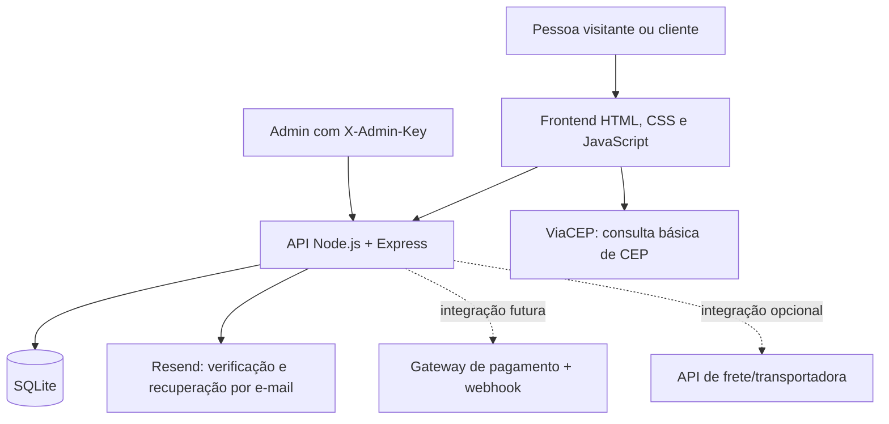

<div align="center">

# 🌿 Loja Verde
### Catálogo de plantas, loja virtual e área comercial

**Uma loja de plantas construída com HTML, CSS, JavaScript, Node.js, Express e SQLite.**

[🚀 Começar](#-início-rápido) · [📊 Dashboard](docs/dashboard.html) · [🖼️ Galeria](#-galeria-do-site) · [🧭 Histórico do projeto](#-histórico-do-projeto) · [🔌 APIs](#-mapa-de-apis) · [✅ Checklist de lançamento](#-checklist-antes-de-lançar)


</div>

---

## 📊 Painel do projeto

> Quer uma visão mais visual? Abra o [**Dashboard interativo**](docs/dashboard.html) no navegador. Ele tem filtros de funcionalidades, busca, indicadores e um checklist de lançamento que guarda suas marcações no navegador.

<table>
  <tr>
    <td width="25%" align="center"><strong>47</strong><br>produtos no catálogo</td>
    <td width="25%" align="center"><strong>30</strong><br>plantas adicionadas</td>
    <td width="25%" align="center"><strong>6/6</strong><br>testes automatizados aprovados*</td>
    <td width="25%" align="center"><strong>3 camadas</strong><br>interface, API e banco</td>
  </tr>
</table>

<details>
<summary><strong>Como ler os status deste README</strong></summary>

- ✅ **Implementado / teste local aprovado:** existe código e há verificação automatizada ou validação estática correspondente.
- 🧪 **Precisa de teste ponta a ponta:** a função foi implementada, mas ainda precisa ser verificada com o servidor completo em execução.
- 🔑 **Depende de credenciais/configuração:** precisa das chaves, domínio, conta de fornecedor ou dados reais da loja.
- 🛠️ **Pendente para operação comercial:** não deve ser tratado como pronto até a integração e o teste real.

**Limite conhecido:** os testes automatizados são principalmente testes de catálogo e inspeções das regras de acesso; eles não comprovam, sozinhos, o funcionamento integrado do banco, envio de e-mail, pagamentos ou implantação pública.
</details>

## 🖼️ Galeria do site

As imagens abaixo são capturas da própria Loja Verde feitas durante o desenvolvimento. Algumas registram etapas anteriores e estão marcadas como históricas; não devem ser interpretadas como prova de que toda integração em produção foi validada.

### Detalhe de produto

<p align="center">
  
</p>

<details>
<summary><strong>Ver navegação por categorias</strong></summary>


A captura registra a navegação que foi evoluída para manter as categorias principais visíveis e agrupar as opções secundárias em uma sanfona.
</details>

<details>
<summary><strong>Ver registro do problema do carrinho durante o desenvolvimento</strong></summary>


Esta captura é **histórica**: registra o estado de erro reportado durante a depuração. A correção foi trabalhada depois, mas a imagem não é uma prova de funcionamento atual.
</details>

<details>
<summary><strong>Ver captura histórica do checkout (antes do fluxo interno atual)</strong></summary>


Esta versão antiga ainda mostrava um botão de finalização associado ao WhatsApp. O código mais recente envia o pedido à API da loja e mostra a confirmação no próprio site; **o print antigo foi mantido somente para documentar a evolução**.
</details>

## ✨ Funcionalidades do projeto

| Área | O que está previsto no projeto | Situação atual |
|---|---|---|
| Catálogo | 47 plantas, categorias, busca, preço, estoque e cuidados | ✅ Catálogo validado por testes |
| Página do produto | Galeria, detalhes, cuidados, avaliações do produto e do produtor | 🧪 Testar no servidor com o banco conectado |
| Conta e perfil | Cadastro, login, verificação por código, edição de perfil, histórico de pedidos e recuperação de senha | 🔑 E-mail real depende do provedor configurado |
| Carrinho | Acesso restrito a conta autenticada, dados isolados por usuário, quantidades e cupom | ✅ Regras de acesso cobertas pelos testes; falta teste ponta a ponta |
| Checkout | Endereço, opção de entrega, observações e registro do pedido no back-end | 🧪 Registrar pedido não é o mesmo que receber pagamento |
| Comerciantes & Grupo VIP | Layout renovado, formulário de parceria e promoções | ✅ Regras de acesso verificadas por teste de código |
| Administração | Catálogo, preço, estoque, pedidos, status, configurações, promoções e avaliações | 🔑 Requer chave administrativa e teste real do servidor |
| Responsividade | Ajustes para telas pequenas, tablet e desktop | 🧪 Foi verificado o CSS; faça o teste nos dispositivos-alvo antes do lançamento |
| Pagamento online | Pix, cartão e boleto | 🛠️ Gateway e webhooks ainda precisam ser integrados |

## 🧭 Histórico do projeto

Este registro resume o processo documentado na conversa de desenvolvimento — da auditoria inicial às melhorias recentes.

<details open>
<summary><strong>Etapa 1 — Auditoria e consolidação da base</strong></summary>

- Foram revisados os arquivos HTML, CSS, JavaScript, scripts de inicialização e back-end existentes.
- A arquitetura alvo foi consolidada em **HTML + CSS + JavaScript no navegador**, **Node.js + Express** no servidor e **SQLite** para persistência.
- A execução local passou a servir a interface e as rotas de API pela mesma origem, reduzindo a dependência de configurar CORS para desenvolvimento local.
- Foi criada uma inicialização para Windows por `iniciar_servidor.bat` e um arquivo de exemplo de variáveis de ambiente.
</details>

<details>
<summary><strong>Etapa 2 — Depuração do carrinho e checkout</strong></summary>

- Foi investigado o estado de erro em que a página do carrinho abria, mas não conseguia carregar os produtos.
- A navegação e a recuperação de informações do carrinho foram reforçadas.
- A finalização foi movida para o fluxo interno: a interface envia os itens ao endpoint `POST /api/pedidos`, o servidor recalcula valores, verifica estoque e registra o pedido, e a loja apresenta um código de confirmação.
- O WhatsApp deixou de ser o destino obrigatório da finalização do pedido. Os links de atendimento ainda podem existir como canal opcional.
- As opções Pix/cartão/boleto mostradas pela interface não constituem, por si só, cobranças reais.
</details>

<details>
<summary><strong>Etapa 3 — Acesso por conta e privacidade básica</strong></summary>

- Foram adicionados fluxos de cadastro, login, verificação de e-mail, reenvio de código e recuperação de senha.
- O perfil permite atualizar os dados de conta e consultar pedidos associados ao usuário autenticado.
- O carrinho e os dados de checkout foram separados por conta no navegador.
- Abrir o carrinho, adicionar produtos, finalizar pedido e usar a área **Comerciantes & Grupo VIP** exigem uma conta verificada; o servidor também protege rotas sensíveis.
- O usuário inicia desconectado quando a página é recarregada, conforme a política definida para esta versão.
</details>

<details>
<summary><strong>Etapa 4 — Catálogo ampliado</strong></summary>

- O catálogo cresceu de 17 para **47 produtos**, com 30 entradas novas.
- As inclusões usam `INSERT OR IGNORE` na inicialização para adicionar itens ausentes sem substituir os preços e estoques que já tenham sido alterados no banco.
- Entraram variedades ornamentais, suculentas, mudas frutíferas e ervas/temperos. As fotos, preços, disponibilidade e cuidados precisam ser revisados pelo responsável pela loja antes de uma venda real.
</details>

<details>
<summary><strong>Etapa 5 — Administração e comerciantes</strong></summary>

- Foi construído um painel de administração com resumo, produtos, estoque, pedidos, promoções, configurações e avaliações.
- As rotas administrativas usam `X-Admin-Key`; a chave é mantida no `.env` e não deve ser publicada.
- A página **Comerciantes & Grupo VIP** recebeu novo layout, cartões de benefícios, formulário comercial e apresentação de promoções.
- A área comercial exige sessão autenticada tanto na interface quanto nos endpoints relevantes.
</details>

<details>
<summary><strong>Etapa 6 — E-mail, APIs e documentação</strong></summary>

- O código integra o envio transacional via **Resend** para código de verificação e recuperação de senha; é preciso fornecer chave e remetente/domínio autorizado para confirmar a entrega real.
- **ViaCEP** auxilia a consulta de CEP, mas não calcula frete nem prazo de transportadora.
- Foram adicionados testes automatizados para regras de acesso e integridade do catálogo.
- Este README ganhou galeria, links internos, tabelas, fluxos Mermaid, seções recolhíveis e um dashboard HTML independente.
</details>

## 🏗️ Arquitetura



### Tecnologias

- **Frontend:** HTML5, CSS3 e JavaScript sem framework obrigatório.
- **Servidor:** Node.js 20+ e Express.
- **Persistência:** SQLite, com dados de catálogo, usuários, pedidos e áreas administrativas.
- **E-mail:** API do Resend, configurada por variáveis de ambiente.
- **CEP:** ViaCEP para consulta simples.
- **Testes:** `node:test` e `node:assert` incluídos no Node.js.

## 🚀 Início rápido

### Windows

1. Instale [Node.js 20 ou superior](https://nodejs.org/).
2. Extraia o ZIP inteiro para uma pasta local — não abra o `index.html` diretamente.
3. Abra o PowerShell na pasta em que está `iniciar_servidor.bat`.
4. Execute:

   ```powershell
   .\iniciar_servidor.bat
   ```

5. Aguarde a instalação das dependências e a inicialização do servidor.
6. Abra [http://127.0.0.1:5000](http://127.0.0.1:5000).

> No PowerShell, use `.\iniciar_servidor.bat` para executar o arquivo da pasta atual. Se aparecer `CommandNotFoundException`, confirme se o terminal está na mesma pasta que contém o `.bat` com `Get-ChildItem`.

### Comandos úteis

```powershell
npm install       # instala as dependências
npm run check     # verifica sintaxe dos JavaScripts
npm test          # executa os testes automatizados
npm start         # inicia o servidor
```

### Abrir o dashboard de documentação

Dê dois cliques em `docs/dashboard.html` para abrir o painel local em um navegador. O arquivo não precisa de Node, banco de dados nem conexão com a internet. Filtros e a checklist são executados no próprio navegador.

## 🔐 Configuração e segurança

- O primeiro início cria ou atualiza `.env` e gera a chave administrativa quando é necessário; guarde-a em local privado.
- **Nunca publique `.env`, `ADMIN_API_KEY`, `OTP_SECRET` ou `RESEND_API_KEY` em repositórios, chats ou capturas de tela.** O `.gitignore` ignora `.env`, diretório de banco, dependências e logs.
- Para usar e-mail real, crie uma chave no [Resend](https://resend.com/), valide seu remetente/domínio e configure `RESEND_API_KEY` e `EMAIL_FROM` no `.env`.
- Em ambiente de produção, configure também `NODE_ENV=production`, segredos persistentes, HTTPS, backups e logs seguros. Não deixe a configuração de demonstração habilitada em uma loja pública.
- A API do servidor é a autoridade para preço, estoque e gravação do pedido; nunca trate valores exibidos só no navegador como prova de cobrança.

Exemplo ilustrativo de `.env` — use os seus próprios valores, não copie chaves de exemplo:

```env
NODE_ENV=production
RESEND_API_KEY=re_sua_chave_real
EMAIL_FROM=Loja Verde <verificacao@seudominio.com>
```

## 🔌 Mapa de APIs

### Serviços externos

| Serviço | Finalidade | Requer configuração? | Limite importante |
|---|---|---|---|
| [Resend](https://resend.com/docs/api-reference/emails/send-email) | Enviar códigos e e-mails de recuperação | **Sim:** chave de API e remetente/domínio verificado | Ainda precisa ser testado com uma caixa real do responsável pela loja |
| [ViaCEP](https://viacep.com.br/) | Consultar dados básicos de um CEP | Não exige chave | Não calcula preço/prazo de entrega |
| Gateway (ex.: [Mercado Pago](https://www.mercadopago.com.br/developers/pt/reference)) | Criar cobranças e confirmar pagamento | **Ainda não integrado** | Exige integração server-side, idempotência e validação de webhook |
| API de frete/transportadora | Cotação e previsão de entrega | Opcional na demonstração; necessária para cotação real | Taxa fixa não equivale a cotação por destino |

### Rotas internas mais relevantes

| Grupo | Endpoints (resumo) | Autorização |
|---|---|---|
| Saúde e catálogo | `GET /api/health`, `GET /api/produtos`, `GET /api/produtos/:id/avaliacoes` | Público |
| Configuração pública | `GET /api/configuracoes/publicas` | Público |
| Contas | `POST /api/auth/registrar`, `/verificar-email`, `/reenviar-codigo`, `/login`, `/solicitar-redefinicao`, `/redefinir-senha` | Fluxos de autenticação e códigos temporários |
| Perfil e histórico | `GET /api/auth/me`, `PATCH /api/auth/perfil`, `GET /api/auth/pedidos`, `POST /api/auth/logout` | Token de sessão |
| Pedidos | `POST /api/pedidos`, `GET /api/pedidos/:codigo` | Criar pedido requer sessão; consulta por código segue a regra implementada pelo servidor |
| Comerciantes/VIP | `POST /api/comerciantes/cadastro`, `GET /api/comerciantes/promocoes` | Token de sessão |
| Avaliações | `POST /api/produtos/:id/avaliacoes` | Token de sessão |
| Administração | `/api/admin/resumo`, `/produtos`, `/pedidos`, `/promocoes`, `/configuracoes`, `/avaliacoes` | Cabeçalho `X-Admin-Key` |

Consulte `server.js` para os contratos exatos, parâmetros e validações de cada endpoint.

## 🧪 Testes e reprodução

Na versão documentada, os seis testes automatizados passam no ambiente local onde foram executados:

1. Acesso ao carrinho, adicionar produtos e área VIP com conta verificada.
2. Separação de carrinho e checkout por usuário.
3. Proteção de API para pedidos e rotas comerciais.
4. Catálogo com 47 IDs exclusivos e sequenciais.
5. Campos mínimos de cada produto.
6. Exatamente 30 produtos novos no intervalo de IDs 18 a 47.

Execute novamente depois de alterar qualquer arquivo:

```powershell
npm run check
npm test
```

**Esses testes não substituem um teste real de ponta a ponta** com dependências instaladas, banco inicializado, uma conta de e-mail real e o servidor em execução.

## 📋 Checklist antes de lançar

- [ ] Substituir número de WhatsApp, e-mail, horário, domínio e contatos de demonstração pelos dados reais.
- [ ] Revisar nomes, fotos/direitos de uso, preços, estoque, categorias e cuidados das 47 plantas.
- [ ] Configurar Resend com remetente autorizado e receber um código numa caixa de e-mail real.
- [ ] Testar cadastro, expiração de código, limite de tentativas, reenvio, login, logout e redefinição de senha.
- [ ] Testar carrinho, checkout, concorrência de estoque, cancelamento e histórico de pedidos com a API real.
- [ ] Integrar gateway e webhooks antes de anunciar que Pix/cartão/boleto aceitam pagamentos online.
- [ ] Definir frete/retirada, áreas atendidas, prazos, comunicação e operação de entrega.
- [ ] Publicar Termos, Política de Privacidade/LGPD, entrega, troca, devolução e garantia revisados.
- [ ] Configurar domínio, HTTPS, segredos persistentes, backup do banco e estratégia de restauração.
- [ ] Fazer teste em celular real e revisão final de acessibilidade, desempenho e mensagens de erro.

## 📁 Estrutura de arquivos

```text
loja-verde/
├── index.html                  # estrutura principal do site
├── style.css                   # visual e responsividade
├── script.js                   # interface, navegação e chamadas à API
├── catalog.js                  # catálogo inicial de 47 plantas
├── server.js                   # API Express, autenticação e SQLite
├── package.json                # comandos, scripts e dependências
├── package-lock.json           # versões resolvidas de dependências
├── .env.example                # modelo de configuração sem segredos reais
├── iniciar_servidor.bat        # inicialização para Windows
├── tests/
│   ├── access-control.test.js  # verificações de regras de acesso
│   └── catalog.test.js         # integridade do catálogo
└── docs/
    ├── dashboard.html          # dashboard local interativo
    └── screenshots/             # capturas do próprio site
```

## 📝 Notas de lançamento

- O dashboard é uma página de documentação local; não é o painel administrativo da loja e não tem acesso ao banco.
- As imagens da pasta `docs/screenshots` são referências do desenvolvimento, incluindo estados antigos explicitamente identificados.
- A loja está preparada para demonstração, desenvolvimento e configuração. Só deve ser anunciada como comércio com pagamento online depois que gateway, webhooks, e-mail, entrega, políticas e hospedagem tiverem sido configurados e testados.

<div align="center">

**Loja Verde 🌿 — do catálogo ao pedido, com cada etapa documentada.**

[↑ Voltar ao topo](#-loja-verde) · [Abrir Dashboard](docs/dashboard.html)

</div>
